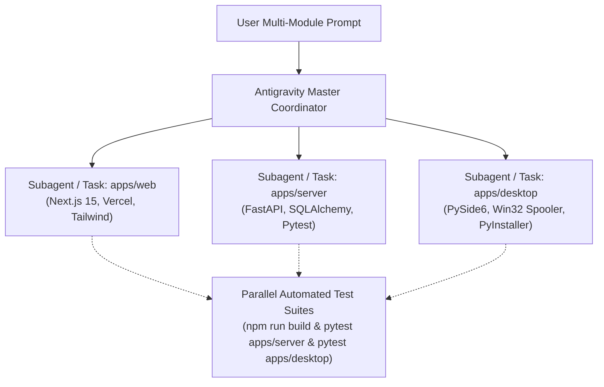

# CBPMS Production Deployment & Multi-Module Execution Guide

This document contains the complete architectural guide for:
1. **How to run Antigravity across multiple project modules concurrently** (including copy-paste prompt templates).
2. **End-to-End Production Deployment** (Supabase Database/Storage -> Render Backend API -> Vercel Next.js Web).
3. **Packaging the Windows Desktop App into an Executable (`.exe`)**.
4. **Route Security & Reverse Proxy Audit**.

---

## Part 1: How Antigravity Works on Multiple Modules Simultaneously

Antigravity operates across a monorepo by orchestrating tasks in parallel while maintaining strict boundary isolation:



### Why Multi-Module Works Without Collisions:
1. **Isolated Working Directories (`Cwd`)**: Subagents and command runners execute in their own isolated folders (`apps/web`, `apps/server`, `apps/desktop`), avoiding file locks or configuration conflicts.
2. **Parallel Daemon/Task Management**: Background tasks (such as `npm run build`, `pytest`, and `pyinstaller`) run concurrently in asynchronous worker threads without blocking terminal interaction.
3. **Contract-Driven Synchronization**: The server defines Pydantic schemas, the web app reflects them in TypeScript interfaces (`apps/web/lib/types.ts`), and the desktop app consumes them via Qt signals (`DesktopAgentController`).

---

### Copy-Paste Prompt Template for Multi-Module Development

Whenever you want Antigravity to build or refactor features across modules at once, copy and paste this exact prompt template into chat:

```markdown
You are working across multiple modules in this repository (apps/server, apps/web, apps/desktop) simultaneously.

[TASK OBJECTIVE]
<Describe your new feature or refactoring here>

[EXECUTION INSTRUCTIONS]
1. Execute this work in parallel across modules without cross-module regression:
   - MODULE A (apps/server): Implement backend data models, API routes, and tests in apps/server/tests.
   - MODULE B (apps/web): Implement TypeScript types, API client calls, and UI components in apps/web.
   - MODULE C (apps/desktop): Implement native PySide6 models, UI views, and Win32 spooler hooks in apps/desktop.
2. Enforce API contract alignment:
   - Verify apps/server schemas match apps/web/lib/types.ts.
   - Verify apps/web/lib/server/policy.ts allows new public routes.
3. Run verification commands concurrently:
   - apps/server: python -m pytest apps/server/tests/
   - apps/web: npm run build (in apps/web)
   - apps/desktop: python -m pytest apps/desktop/tests/
4. Report the status and results across all three modules.
```

---

## Part 2: Step-by-Step Production Deployment Guide

### Phase 1: Database & Storage (Supabase)

1. **Apply SQL Migrations**:
   Open your Supabase Project Dashboard -> **SQL Editor**, and run the migration files located in `supabase/migrations/` in sequential order:
   - `001_initial_schema.sql` (Tables: `shops`, `printers`, `stations`, `users`, `jobs`, `print_tokens`)
   - `002_rls_and_functions.sql` (Security barrier functions & RLS)
   - `003_storage_bucket.sql` (Creates bucket `transient-print-jobs`)
   - `004_close_legacy_public_access.sql` (Enforces private schema)
   - `005_customer_documents_and_audit.sql` (Audit log & customer documents)
   - `006_google_identity_private_records.sql` (Customer Google Auth identities)
   - `007_user_alias_trigger.sql` (Profile alias triggers)

2. **Storage Bucket Verification**:
   - Go to **Storage** -> **Buckets**.
   - Ensure the bucket name is `transient-print-jobs`.
   - Ensure **Public bucket** is **OFF** (all downloads must use short-lived presigned URLs).

3. **Collect Credentials**:
   - **Database Connection String**: Settings -> Database -> Connection String (Use **Session Pooler** on port 5432 or Transaction Pooler on port 6543).
   - **Project URL**: e.g., `https://xyzproject.supabase.co`.
   - **Service Role Key**: Settings -> API -> `service_role` (Secret - for backend only).
   - **Anon/Publishable Key**: Settings -> API -> `anon` (Public - for web frontend).

---

### Phase 2: Cloud Backend API (Render)

1. **Create Web Service on Render**:
   - Connect your GitHub repository.
   - Select **Web Service**.
   - Root Directory: `apps/server`.
   - Runtime: `Python` (or use Docker with `apps/server/Dockerfile`).
   - Build Command: `pip install -r requirements.txt`
   - Start Command: `uvicorn app.main:app --host 0.0.0.0 --port $PORT`
   - Health Check Path: `/health`

2. **Configure Environment Variables on Render**:

| Variable | Recommended Value | Notes |
| :--- | :--- | :--- |
| `ENVIRONMENT` | `production` | Enables strict production guards |
| `DATABASE_URL` | `postgresql://...` | Supabase session/transaction pooler URL |
| `SUPABASE_URL` | `https://xyz.supabase.co` | Your Supabase project URL |
| `SUPABASE_SERVICE_ROLE_KEY` | `ey...` | Supabase service-role key (NEVER expose to frontend) |
| `SUPABASE_STORAGE_BUCKET` | `transient-print-jobs` | Private bucket name |
| `CORS_ORIGINS` | `["https://your-domain.vercel.app"]` | Whitelist your Vercel web domain |
| `ENABLE_API_DOCS` | `false` | Disables `/docs` and `/redoc` in production |
| `PAYMENT_PROVIDER` | `razorpay` (or `disabled`) | Set to `razorpay` for live online payments |
| `RAZORPAY_KEY_ID` | `rzp_live_...` | Razorpay Key ID |
| `RAZORPAY_KEY_SECRET` | `...` | Razorpay Key Secret |
| `BOOTSTRAP_ADMIN_USERNAME` | `admin` | Initial admin username |
| `BOOTSTRAP_ADMIN_PASSWORD` | `StrongAdminPassword123!` | Initial admin password |

3. **Verify Deployment**:
   - Visit `https://your-backend.onrender.com/health`.
   - Expected response: `{"status":"ok"}`.

---

### Phase 3: Customer Web Frontend (Vercel)

1. **Create Project on Vercel**:
   - Import your GitHub repository.
   - Set **Root Directory** to `apps/web`.
   - Framework Preset: `Next.js`.
   - Build Command: `npm run build` (configured automatically via `vercel.json`).

2. **Configure Environment Variables on Vercel**:

> **Critical Security Rule:**
> The Next.js frontend acts as a secure reverse proxy. It never needs the database URL or the Supabase `service_role` key.

| Variable | Value | Notes |
| :--- | :--- | :--- |
| `APP_ORIGIN` | `https://your-domain.vercel.app` | **Strict HTTPS**, no trailing slash |
| `BACKEND_API_URL` | `https://your-backend.onrender.com/api/v1` | Backend URL **must end in `/api/v1`** |
| `SUPABASE_URL` | `https://xyz.supabase.co` | Supabase project URL |
| `SUPABASE_PUBLISHABLE_KEY` | `ey...` | Supabase Anon/Publishable Key |

3. **Deploy & Verify**:
   - Trigger deploy on Vercel.
   - Visit `https://your-domain.vercel.app`.
   - The customer portal and shop pages will connect to your Render backend through `/api/backend/*`.

---

## Part 4: Packaging the Desktop App into a Windows Executable (`.exe`)

The native desktop counter desk is built with PySide6 and interacts directly with the Windows Print Spooler (`win32print`).

We have created an automated packaging script: `apps/desktop/build_exe.py` and spec configuration `apps/desktop/CBPMS_CounterDesk.spec`.

### Step 1: Run the Build Command
Open PowerShell in the project directory and run:

```powershell
# 1. Activate your python environment if using one, or use system python
pip install pyinstaller

# 2. Run the packaging script
python apps/desktop/build_exe.py
```

*Options available:*
- `python apps/desktop/build_exe.py` : Produces a standalone single `.exe` file (`dist/CBPMS_CounterDesk.exe`).
- `python apps/desktop/build_exe.py --debug` : Keeps console window open for diagnostic inspection.
- `python apps/desktop/build_exe.py --onedir` : Generates a folder bundle (faster startup).

### Step 2: Configure Workstation `.env`
On the print shop counter computer, place a `.env` file right next to `CBPMS_CounterDesk.exe`:

```ini
# Production Shop Configuration
SHOP_ID=your-registered-shop-id
CLOUD_API_URL=https://your-backend.onrender.com/api/v1
CLOUD_WS_URL=wss://your-backend.onrender.com/ws/queue
SELECTED_PRINTER_NAME=HP LaserJet Pro M404dn (B&W High Speed)
MOCK_PRINTING=false
RAW_PDF_SUPPORTED=false
```

---

## Part 5: Route Security & Reverse Proxy Audit

The application implements a **fail-closed, defense-in-depth architecture**:

### Verified Route Defenses:
1. **Public Attack Surface Containment**:
   - In `apps/web/lib/server/policy.ts`, `allowedRoute()` acts as a strict whitelist.
   - Only customer actions (`/jobs/stage`, `/payments/verify`, `/customer/documents`, `/shops/*`) can be invoked through the web proxy.
   - Internal operator routes, printer status modifications, and queue release APIs are **blocked from the web proxy** and accessible only by authenticated desktop clients.
2. **Same-Origin Protection**:
   - `sameOrigin(request)` verifies `sec-fetch-site` and `origin` against `APP_ORIGIN`, preventing CSRF attacks from malicious websites.
3. **Double Price Verification**:
   - Calculation is calculated client-side for immediate 0ms UX.
   - At checkout staging (`/jobs/stage` and `/jobs/stage-folder`), the server independently recalculates the cost and compares it against `client_quoted_cost`. If they differ by even 1 paisa, it fails with `409 Quote Mismatch`.
4. **WebSocket Security (`wss://`)**:
   - Desktop connection uses secure WebSocket over TLS (`wss://`) authenticated via shop operator credentials and token handshake.
