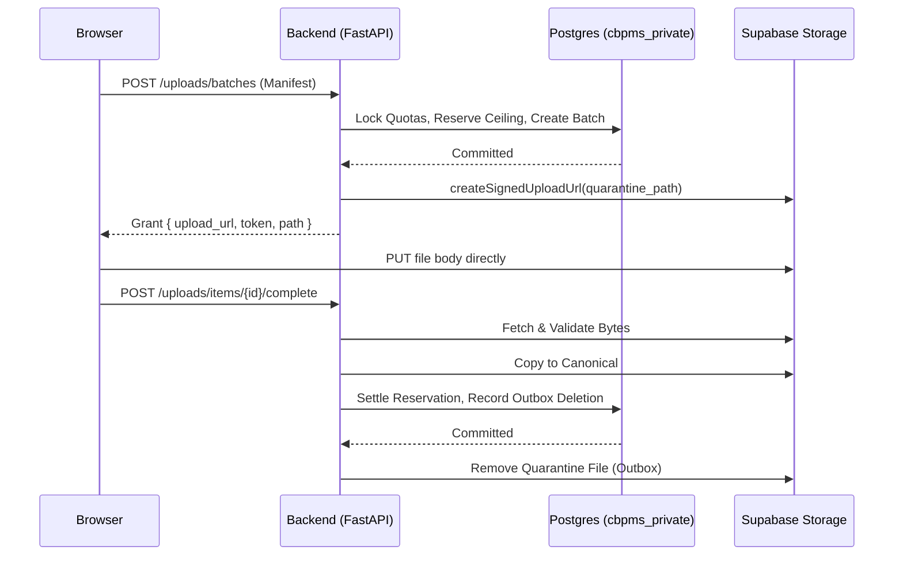

# Architecture Decision Record: Upload Admission & Grant Lifecycle

**Status:** APPROVED  
**Date:** 13 October 2026  
**Context:** Securing print document and customer library uploads against quota bypass, token replay, client tampering, and privacy SLA violations.

---

## 1. Problem Statement

Supabase Storage standard signed upload tokens are valid for 2 hours, are bearer capabilities requiring no subsequent authentication, and cannot be revoked early via an API call. Furthermore, resumable TUS upload sessions can live up to 24 hours. If an application relies solely on client-declared file sizes or post-upload callbacks to enforce quotas and privacy rules:
1. A malicious user could declare a file is 1 MB, obtain a grant, and upload 25 MB, exceeding their quota.
2. A user could reuse an unexpired grant to write after the document was cancelled or deleted.
3. An upload could finalize after our 3-hour privacy deadline has passed.
4. Document bytes traveling through Vercel Functions will fail with HTTP 413 for any payload exceeding 4.5 MB.

---

## 2. Decision & Lifecycle Model

### 2.1 The Quarantine Boundary
Every upload grant is strictly restricted to an isolated quarantine path generated server-side:
```
quarantine/{batch_id}/{item_id}.bin
```
- **No Overwrite (`upsert: false`):** Upload grants never permit overwriting (`x-upsert` header is prohibited).
- **Server-Generated Paths Only:** The browser never supplies the bucket name or destination path.
- **Quarantine Isolation:** Quarantined objects are never directly exposed to shop operators, printers, or download URLs. They can only be promoted to canonical objects after rigorous server-side validation.

---

### 2.2 Admission & Upfront Quota Reservation
1. **Enforced Ceilings vs. Declared Sizes:**
   - The browser provides a declared size in the manifest.
   - The backend validates that `declared_size <= MAX_FILE_SIZE_CEILING` (25 MiB for verified customers, 2 MiB for guests).
   - Before issuing any signed upload token, the backend **reserves the enforced ceiling** (`enforced_ceiling_bytes`) against:
     - `quota_accounts.outstanding_reservation_bytes` (active logical storage cap: 100,000,000 bytes)
     - `quota_daily_usage.outstanding_reservations` (daily UTC admission cap: 100,000,000 bytes)
   - If `current_active + outstanding_reservations + new_enforced_ceiling > CAP`, admission is **rejected with HTTP 403 / 429**.
2. **Atomic SQL Reservation:**
   - The reservation is committed in a single serializable SQL transaction before the upload grant is returned to the client.
   - If the client abandons the transfer or never finalizes, the reservation protects against quota overcommitment until the write horizon closes.

---

### 2.3 Promotion to Canonical Artifact
1. When the client completes the transfer, it calls `POST /api/v1/uploads/items/{id}/complete`.
2. The server downloads the quarantined object and verifies:
   - Magic bytes (PDF `%PDF-`, PNG `\x89PNG`, JPEG `\xff\xd8\xff`).
   - True byte length: must be $\le \text{enforced ceiling}$.
   - SHA-256 hash calculation.
   - Page count and format constraints (e.g. non-encrypted, reasonable page count).
3. Upon successful validation, the server copies the verified object to canonical storage:
   ```
   canonical/{purpose}/{artifact_id}.bin
   ```
4. In a finalization transaction:
   - The actual observed size is charged to `quota_accounts.active_canonical_bytes` and `quota_daily_usage.charged_bytes`.
   - The reservation `enforced_ceiling_bytes` is safely released.
   - The original quarantine object is scheduled for immediate deletion via the outbox.

---

### 2.4 Handling Expired, Cancelled, and Late Writes
1. **The 3-Hour Privacy Deadline:**
   - Every print upload batch has an immutable `expires_at = created_at + 10,800` seconds (3 hours).
   - Any finalization attempt occurring after `now() > expires_at` is rejected with `HTTP 410 Gone`.
2. **Late TUS Completion Protection:**
   - Because TUS servers may accept chunks up to 24 hours, the backend finalizer verifies whether the batch or item was marked cancelled or expired.
   - If an unfinalized quarantined file is detected after the 2-hour signed URL horizon or 3-hour batch horizon, the background cleanup sweeper purges the quarantine object via the Supabase Storage API.
3. **Write-After-Delete & Tombstones:**
   - When a user deletes a temporary document or cancels an upload batch, a tombstone record is retained until the 2-hour grant horizon has fully elapsed.
   - Even if the bearer token is replayed to upload bytes to the quarantine path, the backend rejects completion, treats the file as orphaned, and schedules it for deletion.

---

### 2.5 Outbox Pattern for Non-ACID Storage Operations
External HTTP calls to Supabase Storage cannot share a PostgreSQL ACID transaction. Therefore:

If the backend crashes at any point:
- Outstanding reservations survive in the database.
- Cleanup tasks in `background_tasks` are picked up by the independent scheduled worker.
- No partial or corrupted state can compromise system accounting or privacy.
